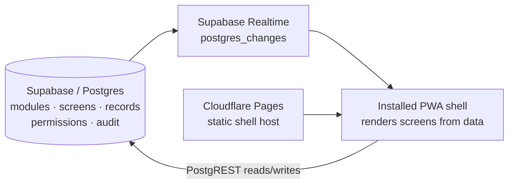

# Nova LiveOS

**One installable shell. Everything else is data.**

Nova LiveOS is the serverless Nova platform. It is a single app people install
on a phone or desktop — and that app ships *empty*. Every screen, feature,
module and permission inside it lives in a database (Supabase/Postgres) as
data, and is pushed to every installed copy **live, in real time**. Change a
row in the database and every copy in the world updates itself. No server to
run, no redeploy, no app-store update.

Version 0.1.0 · A Nova company

## Why this exists

Every conventional product needs a server or VM running behind it around the
clock — and servers die, disks fill, tunnels break, and units vanish on
restart. LiveOS is built the opposite way: there is **no server of ours at
all**. The only things that run are:

- **Supabase** — a hosted Postgres database that stores everything and pushes
  changes to clients in real time (Realtime). Logic lives in Postgres: tables,
  row-level security, and data — not in application servers.
- **Cloudflare Pages** — a static host for the shell's files. It serves the
  empty app; it runs none of your business logic.
- **The shell** — an installable PWA in the user's browser. It renders screens
  from database rows.

If the shell's host has a bad day, the data is untouched. If you edit the
data, every shell follows. The fragile middle layer — your own server — is
simply gone.

## Modules are data

A *module* is a row in the `modules` table plus its *screens* — layout
documents (JSON arrays of blocks: hero, text, stats, cards, list, form,
action-button) that the shell renders generically. Installing a module is a
row in `module_installs`. A module's own data — products, notes, jobs, orders,
bids — lives in one generic `records` table as JSON payloads.

That means a new product feature can be shipped by inserting rows:

1. Insert a module and a screen.
2. It appears in the Module Store for every user.
3. They install it; it appears in their navigation — live, with no app update.

Three proof modules ship in the seed and work end-to-end:

| Module | Proves | Try it |
|---|---|---|
| **Team Board** | Collaboration | Add a note; it appears in the shared list and persists |
| **Mini Shop** | Commerce | Products are records; ordering writes an order record |
| **Agent Floor** | Agents | Post a job; bid on a job; agents are records too |

## Install your own copy

LiveOS is installable WordPress-style, but serverless: the installer
provisions it onto **your own** Supabase and Cloudflare accounts.

```bash
cp .env.example .env   # fill in your NEW Supabase project's URL + anon key
./install.sh
```

Full step-by-step: [docs/INSTALL.md](docs/INSTALL.md). Architecture:
[docs/ARCHITECTURE.md](docs/ARCHITECTURE.md).

> Always use a **fresh** Supabase project for LiveOS. The shell takes its
> project URL + anon key from `public/config.js` — that file is the only
> wiring between a shell copy and its database.

## Run it locally (no account needed)

With no Supabase configured, the shell runs in **local mode** on built-in
fixture data — installs, records and live-change simulation all work offline:

```bash
npm run serve    # http://localhost:8901
npm test         # unit tests: schema, renderer, store, adapters
```

Use the **Simulate live change** button to watch a screen definition change
in the data layer and the shell re-render in place, without a reload — the
same thing that happens from a database edit once Supabase is wired.

## Architecture at a glance



There is deliberately no box labelled "our server".

## Layout of this repo

```
public/          the shell (index.html, app.js, styles.css, config.js,
                 manifest.webmanifest, sw.js, lib/ data layer + renderer)
supabase/
  migrations/    0001_kernel.sql — kernel schema, RLS, realtime publication
  seed.sql       the three proof modules, their screens and demo data
install.sh       idempotent installer (fail-closed)
docs/            INSTALL.md, ARCHITECTURE.md
tests/           run.mjs (unit suite), browser_pass.py (Chromium QA pass)
```
