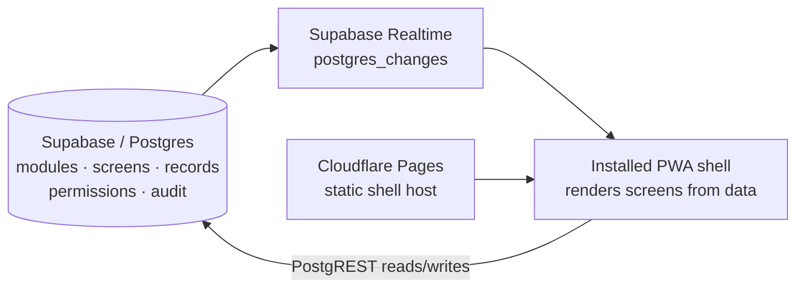

# Nova LiveOS

**One installable shell. Everything else is data.**

Nova LiveOS is the serverless Nova platform. It is a single app people install
on a phone or desktop — and that app ships *empty*. Every screen, feature,
module and permission inside it lives in a database (Supabase/Postgres) as
data, and is pushed to every installed copy **live, in real time**. Change a
row in the database and every copy in the world updates itself. No server to
run, no redeploy, no app-store update.

Version 1.0.0 "Advanced" · A Nova company

## Why this exists

Every conventional product needs a server or VM running behind it around the
clock — and servers die, disks fill, tunnels break, and units vanish on
restart. LiveOS is built the opposite way: there is **no server of ours at
all**. The only things that run are:

- **Supabase** — a hosted Postgres database that stores everything and pushes
  changes to clients in real time (Realtime). Logic lives in Postgres: tables,
  row-level security, and data — not in application servers.
- **Cloudflare Pages** — a static host for the shell's files. It serves the
  empty app; it runs none of your business logic.
- **The shell** — an installable PWA in the user's browser. It renders screens
  from database rows.

If the shell's host has a bad day, the data is untouched. If you edit the
data, every shell follows. The fragile middle layer — your own server — is
simply gone.

## Modules are data

A *module* is a row in the `modules` table plus its *screens* — layout
documents (JSON arrays of blocks) that the shell renders generically.
Installing a module is a row in `module_installs`. A module's own data —
tasks, messages, products, orders, jobs, bids, contacts — lives in one
generic `records` table as JSON payloads. Each module carries its own
hand-crafted SVG app icon (a slug from the shell's icon library, stored in
the module's manifest) shown in the drawer, the Store, on Home and in
search results.

That means a new product feature can be shipped by inserting rows:

1. Insert a module and a screen.
2. It appears in the Module Store for every user.
3. They install it; it appears in their navigation — live, with no app update.

## What's in v1.0.0 "Advanced"

- **Real-time everything** — modules, screens, records, kanban moves, chat,
  orders, bids, analytics, notifications, the audit feed and presence all
  update in every open shell with no reload (Realtime `postgres_changes`,
  5-second polling floor; in local mode, a cross-tab storage bus). Every
  mutation is optimistic: instant local echo, then server confirmation.
  Proven end-to-end by a two-shell browser test.
- **Authentication** — Supabase Auth over plain REST: email + password,
  magic links, persisted sessions with refresh. Signing in swaps the shell
  identity to your account and migrates your anonymous installs.
- **Admin Console** — Screen Editor (structured block editor with live
  preview), Module Manager (create/edit/publish, visual icon picker),
  Records Browser, Activity (audit log), Automations.
- **An automation engine in the shell** — enabled rules evaluate the moment
  data changes (an order lands in the Analytics activity stream; a bid is
  logged; a job posting is audited) and every run is written to the audit
  log. Database triggers (migration 0003) independently audit *all* changes.
- **A richer renderer** — kanban (drag between columns), sortable tables,
  galleries, hand-rolled SVG bar/line charts from live record aggregations,
  a safe markdown subset, dividers, notes and a cart block — on top of the
  original seven block types.
- **Platform furniture** — global search + command palette (Ctrl+K),
  notifications centre with unread badge, live presence count, keyboard
  shortcuts, PWA install prompt, offline banner, skeleton loaders, animated
  counters — under a classical white Nova design: serif display type, the
  real Nova logo, green/pink used sparingly.

Six modules ship in the seed and work end-to-end:

| Module | Proves | Try it |
|---|---|---|
| **Team Board** | Collaboration | A real kanban: add a task, drag it to Done — every shell follows |
| **Team Chat** | Live messaging | Post a message; it appears in every open shell instantly |
| **Mini Shop** | Commerce | Fill a cart, check out; the order joins the shared history |
| **Agent Floor** | Agents | Post a job; bid on it; watch the job's bid count update live |
| **Analytics** | Insight | Charts computed live from records across all modules |
| **Contacts CRM** | Business data | Add a contact; sort the table; move them through the pipeline board |

## Install your own copy

LiveOS is installable WordPress-style, but serverless: the installer
provisions it onto **your own** Supabase and Cloudflare accounts.

```bash
cp .env.example .env   # fill in your NEW Supabase project's URL + anon key
./install.sh
```

Full step-by-step: [docs/INSTALL.md](docs/INSTALL.md). Architecture:
[docs/ARCHITECTURE.md](docs/ARCHITECTURE.md).

> Always use a **fresh** Supabase project for LiveOS. The shell takes its
> project URL + anon key from `public/config.js` — that file is the only
> wiring between a shell copy and its database.

## Run it locally (no account needed)

With no Supabase configured, the shell runs in **local mode** on built-in
fixture data — installs, records and live-change simulation all work offline:

```bash
npm run serve    # http://localhost:8901
npm test         # unit tests: schema, renderer, store, adapters
```

Use the **Simulate live change** button to watch a screen definition change
in the data layer and the shell re-render in place, without a reload — the
same thing that happens from a database edit once Supabase is wired.

## Architecture at a glance



There is deliberately no box labelled "our server".

## Layout of this repo

```
public/          the shell (index.html, app.js, styles.css, config.js,
                 manifest.webmanifest, sw.js)
  lib/           core.mjs renderer · data.mjs adapters · icons.mjs icon
                 library · features.mjs cart/search/admin/automation logic
                 auth.mjs Supabase Auth REST client · net.mjs resilient fetch
                 seed-data.mjs local fixtures (mirrors supabase/seed.sql)
supabase/
  migrations/    0001_kernel.sql — kernel schema, RLS, realtime publication
                 0002_installs_anon.sql — per-browser install policies
                 0003_advanced.sql — audit triggers, admin/automation policies
  seed.sql       the six modules, their screens and demo data
install.sh       idempotent installer (fail-closed)
docs/            INSTALL.md, ARCHITECTURE.md
tests/           run.mjs (unit suite), browser_pass.py (Chromium QA pass,
                 incl. the two-shell real-time acceptance)
```
