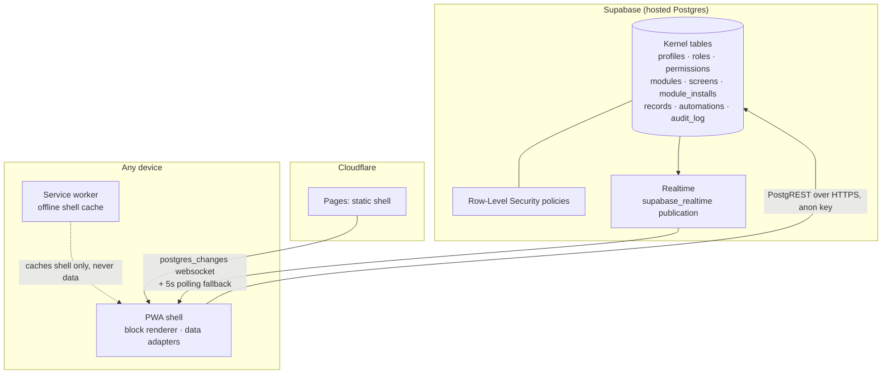

# Nova LiveOS architecture — v1.0.0

## Principle

**Software lives in the database, not on a server.** The shell is a static,
installable PWA that renders whatever the database says. Postgres (Supabase)
is the backend: storage, security (RLS), the realtime bus and the audit
trail. Cloudflare Pages is only the front door for the static files.

## Components

## Kernel tables

| Table | Holds |
|---|---|
| `profiles` | People (optionally linked to a Supabase Auth user) |
| `roles`, `permissions`, `role_permissions`, `user_roles` | Who may do what |
| `modules` | Installed-able products as data: slug, version, manifest JSON, optional bundle URL, published flag |
| `screens` | Layout documents: ordered JSON block arrays per module |
| `module_installs` | Which user installed which module, and when |
| `records` | Generic module data: `module_slug + kind + payload jsonb` |
| `automations` | Named trigger → action definitions |
| `audit_log` | Insert-only event trail |

Every kernel table is added to the `supabase_realtime` publication by the
migration, so any insert/update/delete can reach open shells.

## The block renderer

Screens are arrays of blocks. The shell's renderer (`public/lib/core.mjs`,
pure functions, unit-tested) supports: `hero`, `text`, `stats`, `cards`,
`list`, `form`, `action-button`. Blocks can bind to data:

- `list` / `cards` take a `source` (`module_slug` + `kind`) and render
  matching `records`.
- `form` and button actions declare intents — `create-record`,
  `create-record-from-source`, `create-record-for-item`, `navigate` — which
  the shell executes through the data adapter. A screen therefore carries
  behaviour as well as layout, without shipping code.

## Data adapters

One interface, two implementations (`public/lib/data.mjs`), selected from
`public/config.js`:

- **LocalAdapter** — fixture seed in `localStorage`; same-tab event bus plus
  cross-tab `storage` events provide the live path. Used for demos,
  development and offline work; needs no account.
- **SupabaseAdapter** — PostgREST via `fetch` with the anon key; a Realtime
  websocket (phoenix protocol, `postgres_changes` on modules/screens/
  records/module_installs) where it connects, and a 5-second polling
  fallback that diffs a state hash and re-renders on change — so "live"
  never silently degrades to "stale".

Adding a backend later means adding an adapter, not touching the shell.

## Security posture (v1.0.0)

- The shell only ever contains the **anon** key. There is no service-role key
  in the repo, the config, or the client.
- RLS is enabled on every kernel table. Published modules/screens are
  world-readable; installs and record writes are scoped to their owner;
  clients can insert into `audit_log` but never update or delete it.
- Policies work both anonymously (per-browser UUID for installs) and with
  Supabase Auth sessions (`auth.uid()`). v1.0's Admin Console writes the
  catalogue through the pragmatic policies listed in migration 0003's
  header — the documented follow-up is binding those writes to an admin
  role check once a deployment wants per-admin enforcement.

## Failure thinking

- **Shell host down** → data unaffected; redeploy the static folder anywhere.
- **Realtime socket down** → polling fallback keeps the shell current.
- **Database edit is bad** → screens/modules are rows; fix the row and every
  client recovers on the next change event. There is nothing to roll back on
  a server because there is no server.
